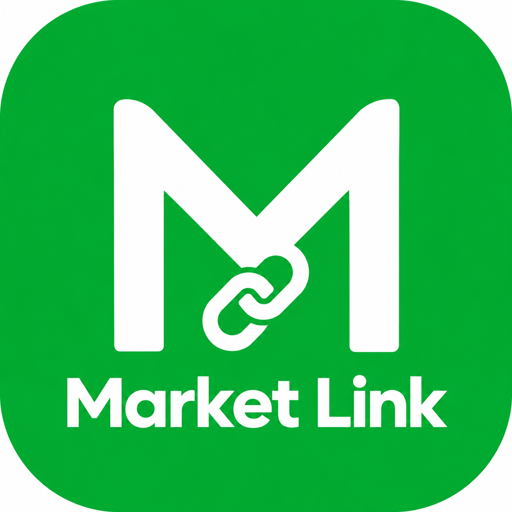
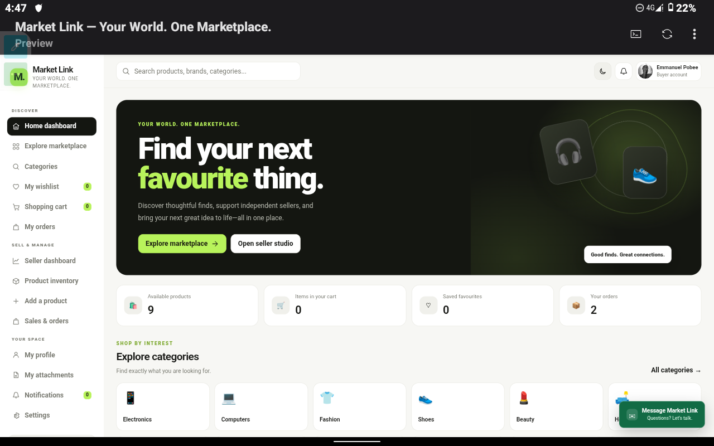

 

# MARKET LINK

### Your Marketplace. Your Connections. Your Opportunities.

 

Discover products. Connect with sellers. Trade with confidence.

 

 

**DISCOVER** &nbsp; · &nbsp; **CONNECT** &nbsp; · &nbsp; **TRADE**

 

---

A modern marketplace experience designed to bring buyers and sellers closer together.

   

✦ Simple discovery. Direct connections. Smarter trading. ✦

---

"01" — THE VISION

<table>
<tr>
<td width="100%">🌿 More Than a Marketplace

Market Link is built around one simple idea: make buying and selling easier by connecting people directly.

Designed with a modern green identity, a clean interface, and a mobile-friendly approach, Market Link aims to make product discovery and seller communication feel natural and effortless.

</td>
</tr>
</table>

---

"02" — THE EXPERIENCE

Thoughtfully designed. Intentionally simple.

<table>
<tr>
<td width="50%" valign="top">🛍️   Product Discovery

Explore products through a marketplace experience designed to help buyers find what they need.

</td>
<td width="50%" valign="top">🤝   Direct Connections

Bring buyers and sellers closer through accessible communication and product enquiries.

</td>
</tr>
<tr>
<td width="50%" valign="top">📱   Mobile-First Feel

A responsive design approach intended to deliver a comfortable experience across different screen sizes.

</td>
<td width="50%" valign="top">🌱   Green Identity

An emerald-inspired visual identity that communicates freshness, growth, opportunity, and trust.

</td>
</tr>
</table>«Design philosophy: Less friction. Better discovery. Stronger connections.»

---

"03" — THE VISUAL LANGUAGE

A palette inspired by growth.

<table>
<tr>
<td align="center" width="25%">Forest Black

"#061A12"

</td>
<td align="center" width="25%">Deep Emerald

"#064E3B"

</td>
<td align="center" width="25%">Market Green

"#087443"

</td>
<td align="center" width="25%">Fresh Mint

"#20C878"

</td>
</tr>
</table>
Dark foundations. Confident emeralds. Bright accents.

---

"04" — TECHNOLOGY & STRUCTURE

Market Link's frontend is built around the core technologies of modern web development.

Technology| Purpose
HTML5| Page structure and content
CSS3| Visual design, layouts, and responsive styling
JavaScript| Interactive behaviour and application logic

The badges represent the intended core frontend stack. Adjust them if your actual implementation uses different technologies.

---

"05" — GETTING STARTED

Run Market Link Locally

Step 01 — Clone the repository

git clone https://github.com/junior-pobee/MarketLink.git

Step 02 — Enter the project directory

cd MarketLink

Step 03 — Open the application

If your project uses a standalone "index.html", open it in your browser or launch it using the Live Server extension in Visual Studio Code.

«Replace the repository URL above if your actual GitHub repository has a different name or location.»

---

"06" — PROJECT STATUS

Market Link is an evolving project. Its capabilities, integrations, and deployment status depend on the features implemented in the current version.

---

"07" — THE DEVELOPER

Emmanuel Pobee

Student Developer · Front-End Developer · Founder of Adapt OS

Building practical digital experiences through creativity, experimentation, and continuous learning.

 
---

"08" — THE PHILOSOPHY

 GOOD DESIGN ATTRACTS.
GOOD EXPERIENCES CONNECT.
GOOD IDEAS CREATE OPPORTUNITIES.

 Market Link — Connecting people to possibilities.

Preview 

 Designed with intention by <b>Emmanuel Pobee</b> · Market Link

 Stay Stoic. Stay Becoming.

